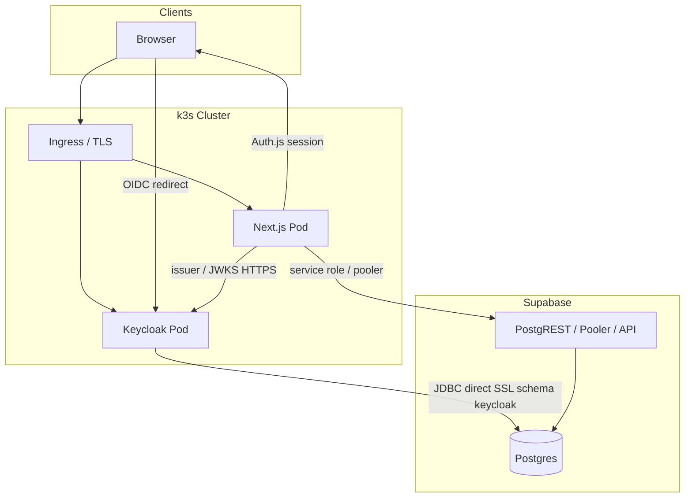

# Shop Sample — Architecture

React + Next.js + TypeScript 기반의 간단한 쇼핑몰 샘플 프로젝트입니다.  
계정은 Keycloak, 데이터는 Supabase(Postgres), 배포는 k3s를 사용합니다.

## Goals

- 웹 브라우저만 대상 (모바일 앱 / 외부 REST 소비자 없음 → 비즈니스 REST API는 선택)
- 인증·계정: Keycloak (OIDC)
- 애플리케이션 데이터: Supabase Postgres
- k3s 클러스터 내부: **Next.js**, **Keycloak** (DB는 모두 **Supabase Postgres**)

## Tech Stack

| Layer | Technology | Role |
|-------|------------|------|
| UI | React + TypeScript | Client Components, 폼·인터랙션 |
| App framework | Next.js (App Router) | 라우팅, SSR/RSC, Server Actions, (선택) Route Handlers |
| Auth | Keycloak + Auth.js | 로그인, 세션, Realm 역할 |
| Database | Supabase (PostgreSQL) | 쇼핑몰 도메인 데이터 + **Keycloak persistence** (스키마 분리) |
| Identity (runtime) | Keycloak on k3s | OIDC; DB는 Supabase 직접 연결 |
| Orchestration | k3s | Deployment, Service, Ingress, Secrets |
| TLS | cert-manager + Ingress | Let's Encrypt (권장) |

## High-Level Architecture



### Responsibility Split

| System | Owns |
|--------|------|
| **Keycloak** | Identity: login, logout, registration (realm policy), roles (`customer`, `admin`) |
| **Supabase** | Postgres: 앱 테이블(`public` 등) + Keycloak 테이블(`keycloak` 스키마). **Supabase Auth는 사용하지 않음** |
| **Next.js** | UI, server-side business logic, session (Auth.js), DB access from server only |

## Application Architecture (Next.js)

Next.js는 REST API 전용 프레임워크가 아니라 **React 풀스택** 프레임워크입니다.  
웹만 서비스할 때는 Server Components + Server Actions로 비즈니스 REST 없이 구현할 수 있습니다.

### Rendering & Data Access

| Use case | Pattern |
|----------|---------|
| Product list / detail (SEO) | **Server Components** → `lib/*` → Supabase |
| Cart, checkout, profile | **Server Actions** + `auth()` |
| Admin product CRUD (optional) | Server Actions or `app/api/admin/*` Route Handlers |
| Login / logout | **Auth.js** Keycloak provider |

비즈니스 REST API(`/api/products` 등)는 **필수 아님**.  
외부 연동·웹훅·모바일 앱 추가 시 [Route Handlers](https://nextjs.org/docs/app/building-your-application/routing/route-handlers)로 확장.

### Suggested Directory Layout

```text
shop/
├── nextjs/                  # Next.js app (npm install / dev / build here)
│   ├── app/
│   │   ├── (shop)/          # storefront routes
│   │   ├── admin/           # role-guarded admin UI
│   │   ├── api/auth/[...]   # Auth.js (if used)
│   │   └── actions/         # Server Actions (cart, orders)
│   ├── components/          # React components
│   ├── lib/
│   │   ├── supabase-server.ts
│   │   ├── auth.ts
│   │   ├── products.ts
│   │   ├── cart.ts
│   │   └── orders.ts
│   ├── types/
│   └── middleware.ts        # path-based auth redirect
├── supabase/
│   └── keycloak-schema.sql  # Keycloak 스키마 선행 생성
├── Dockerfile               # (under nextjs/ when added)
└── k8s/
    ├── namespace.yaml
    ├── keycloak/            # Keycloak manifests, supabase.env, deploy scripts
    └── shop/                # Next.js (추가 예정)
```

### Auth Flow

1. User hits protected route → `middleware.ts` checks session cookie → redirect to login if missing.
2. Login → Auth.js → Keycloak OIDC → callback → session cookie (HTTP-only).
3. First login: upsert `users` row keyed by Keycloak `sub` (+ email, name).
4. Server Actions / RSC: `const session = await auth()` → use `sub` or mapped `users.id` for Supabase queries.
5. Admin routes: Keycloak realm/client role `admin` mapped into session (Auth.js callbacks).

### Authorization

백엔드 전용 프레임워크(Nest/Spring)의 Guard·Interceptor 파이프라인과 달리, Next에서는 다음 조합을 사용합니다.

- **middleware.ts** — 경로 단위 세션 유무·리다이렉트
- **`requireSession()` / `requireRole()`** — Server Action·Route Handler·RSC 진입 시 공통 헬퍼
- Keycloak = 역할의 source of truth

## Data Model (Minimal)

```text
users
  id (uuid, PK)
  keycloak_sub (text, unique)
  email, display_name
  created_at

products
  id, name, description, price, stock, image_url, created_at

cart_items
  user_id → users.id, product_id → products.id, quantity
  unique (user_id, product_id)

orders
  id, user_id, status, total, created_at

order_items
  order_id, product_id, quantity, unit_price
```

- Migrations: Supabase SQL editor, or Drizzle/Prisma against `DATABASE_URL` (pooler).
- Types: `supabase gen types typescript` or ORM-generated types → import in `types/` and `lib/`.

### Supabase: App vs Keycloak (same project)

| Consumer | Connection | Schema | Notes |
|----------|------------|--------|--------|
| **Next.js** | Supabase JS (service role) or ORM pooler | `public` (shop tables) | RLS optional; server-only access 권장 |
| **Keycloak** | JDBC **direct** (`db.<ref>.supabase.co:5432`, `sslmode=require`) | `keycloak` | Transaction pooler(6543)는 마이그레이션 이슈 가능 — **Direct** 권장 |

배포 전 Supabase SQL Editor에서 [`supabase/keycloak-schema.sql`](supabase/keycloak-schema.sql) 실행:

```sql
CREATE SCHEMA IF NOT EXISTS keycloak;
```

Keycloak Deployment env: `KC_DB_SCHEMA=keycloak` (매니페스트에 반영됨).

## Keycloak Supabase 환경 파일 (`k8s/keycloak/supabase.env`)

Keycloak k3s 배포에 필요한 **Supabase DB 연결 정보**와 **Admin Console / 공개 호스트** 설정을 한 파일에 둡니다.  
값은 Git에 올리지 않으며, 배포 스크립트가 읽어 Kubernetes Secret을 생성합니다.

### 파일 구성

| 파일 | Git | 용도 |
|------|-----|------|
| [`k8s/keycloak/supabase.env.example`](k8s/keycloak/supabase.env.example) | 포함 | 변수 설명·템플릿 |
| `k8s/keycloak/supabase.env` | **제외** (`.gitignore`) | 실제 비밀값 입력 |

처음 설정:

```bash
cp k8s/keycloak/supabase.env.example k8s/keycloak/supabase.env
# supabase.env 편집 후 배포
```

### 환경 변수

| 변수 | 필수 | 설명 |
|------|------|------|
| `KC_DB_URL` | 예* | Keycloak JDBC URL. **호스트만 넣으면 안 됨** — `:5432/postgres?sslmode=require`까지 포함 |
| `KC_DB_USERNAME` | 예 | Supabase DB 사용자. Pooler: `postgres.<project-ref>` / Direct: `postgres` |
| `KC_DB_PASSWORD` | 예 | Supabase **Database password** (Dashboard → Project Settings → Database). anon/service role key 아님 |
| `KC_BOOTSTRAP_ADMIN_USERNAME` | 예 | Keycloak master realm Admin Console 사용자명 |
| `KC_BOOTSTRAP_ADMIN_PASSWORD` | 예 | Admin Console 비밀번호 |
| `KEYCLOAK_HOSTNAME` | 예 | 공개 도메인 (`KC_HOSTNAME` + Ingress host). 예: `auth.example.com` |
| `SUPABASE_DB_HOST` | 조건부 | `KC_DB_URL`을 비울 때만. `deploy.sh`가 JDBC URL 조합 |
| `SUPABASE_DB_PORT` | 아니오 | 기본 `5432` |
| `SUPABASE_DB_NAME` | 아니오 | 기본 `postgres` |

\* `KC_DB_URL` 대신 `SUPABASE_DB_HOST`(+ port/name)만 적어도 됩니다.

**JDBC URL 예시 (Direct, 권장):**

```bash
KC_DB_URL=jdbc:postgresql://db.YOUR_PROJECT_REF.supabase.co:5432/postgres?sslmode=require
KC_DB_USERNAME=postgres
```

**Pooler (Session mode, port 5432) 예시:**

```bash
KC_DB_URL=jdbc:postgresql://aws-0-REGION.pooler.supabase.com:5432/postgres?sslmode=require
KC_DB_USERNAME=postgres.YOUR_PROJECT_REF
```

### 배포 스크립트

| 스크립트 | 하는 일 |
|----------|---------|
| [`k8s/keycloak/deploy.sh`](k8s/keycloak/deploy.sh) | `supabase.env` 로드 → Secret `keycloak` 생성 → Deployment·Service·Ingress 적용 |
| [`k8s/keycloak/sync-admin-password.sh`](k8s/keycloak/sync-admin-password.sh) | Admin 비밀번호를 env와 DB에 맞춤 (아래 “Admin 비밀번호” 참고) |

```bash
cd k8s/keycloak
./deploy.sh
```

`deploy.sh`는 Secret을 **삭제 후 재생성**하므로, `supabase.env`를 수정한 뒤 다시 실행하면 DB·bootstrap 값이 Secret에 반영됩니다. Deployment Pod는 필요 시 `kubectl rollout restart deployment/keycloak -n shop`으로 재시작합니다.

### Admin Console 비밀번호 (Keycloak 26)

- `KC_BOOTSTRAP_*`는 **Supabase에 Keycloak 스키마가 처음 초기화될 때만** master admin 생성에 쓰입니다.
- 이미 admin 사용자가 있으면 env만 바꿔서는 **Admin Console 로그인 비밀번호가 바뀌지 않습니다.**
- env와 Console 비밀번호를 맞추려면:

```bash
cd k8s/keycloak
./sync-admin-password.sh
```

Keycloak 26 bootstrap 계정은 **임시 admin**(`is_temporary_admin`)입니다. Console 로그인 후 영구 admin을 만들고 임시 계정을 삭제하는 것을 권장합니다.

### Supabase 사전 작업

1. SQL Editor에서 [`supabase/keycloak-schema.sql`](supabase/keycloak-schema.sql) 실행 (`CREATE SCHEMA keycloak`).
2. 상품 카탈로그: [`supabase/products-schema.sql`](supabase/products-schema.sql) 실행 (`public.products` + 샘플 시드).
3. 장바구니: [`supabase/cart-schema.sql`](supabase/cart-schema.sql) 실행 (`public.users`, `public.cart_items`).
4. `supabase.env`에 Database password·JDBC URL 입력.
5. `./deploy.sh` 실행.
6. 로컬 Next.js: `./scripts/sync-nextjs-supabase-env.sh` 로 `nextjs/.env.local` 생성 (프로덕션 k8s는 `shop.env`에 `SUPABASE_SERVICE_ROLE_KEY` 또는 `DATABASE_URL` 추가).

### k8s/keycloak 디렉터리

```text
k8s/keycloak/
├── supabase.env.example   # 템플릿
├── supabase.env           # 로컬 전용 (gitignore)
├── deploy.sh              # Secret + 매니페스트 배포
├── sync-admin-password.sh # Admin 비밀번호 동기화
├── keycloak.yaml
├── ingress.yaml
└── kustomization.yaml
```

## Security

| Secret / config | Where |
|-----------------|--------|
| `AUTH_SECRET` | k3s Secret, never in repo |
| Keycloak client secret (confidential client) | k3s Secret |
| `SUPABASE_SERVICE_ROLE_KEY` | k3s Secret (Next) — **server only**, never `NEXT_PUBLIC_*` |
| `KC_DB_URL`, `KC_DB_PASSWORD` | k3s Secret (Keycloak) — Supabase **database** password, not anon key |
| `NEXT_PUBLIC_SUPABASE_URL` | public OK |
| Keycloak redirect URIs | must match Ingress host (HTTPS in prod) |

- All cart/order mutations run on server (Server Actions or Route Handlers).
- Prefer Supabase access from Next server only (service role or direct Postgres with pooler).

## Deployment (k3s)

**Next.js**와 **Keycloak** Pod는 **k3s** 안에서 실행하고, **데이터는 Supabase Postgres 하나**에 둡니다 (스키마로 분리).

### Components

| Workload | Namespace | Notes |
|----------|-----------|--------|
| **keycloak** | `shop` | Supabase JDBC; `KC_DB_SCHEMA=keycloak` |
| **shop-next** | `shop` | Next.js `output: 'standalone'`, port 3000 — [`k8s/shop/`](k8s/shop/) |
| **ingress** | `shop` | `shop.example.com` → Next; `auth.example.com` → Keycloak |

### Keycloak (in-cluster → Supabase DB)

매니페스트·환경 파일: [`k8s/keycloak/`](k8s/keycloak/).  
Supabase 연동 설정은 위 **[Keycloak Supabase 환경 파일](#keycloak-supabase-환경-파일-k8skeycloaksupabaseenv)** 섹션을 따릅니다.

```bash
# 1) supabase/keycloak-schema.sql
# 2) k8s/keycloak/supabase.env 작성
# 3) cd k8s/keycloak && ./deploy.sh
```

| Resource | Service DNS (cluster) |
|----------|------------------------|
| Keycloak HTTP | `http://keycloak.shop.svc.cluster.local:8080` |

**Issuer (Auth.js / OIDC):** 브라우저와 토큰 검증 모두 **공개 URL** 기준으로 통일합니다.

```text
KEYCLOAK_ISSUER=https://auth.example.com/realms/<realm-name>
```

Keycloak Admin Console: `https://<KEYCLOAK_HOSTNAME>/admin/` (자격 증명은 `supabase.env`의 `KC_BOOTSTRAP_ADMIN_*`).

Ingress 클래스·issuer 이름(`traefik`, `letsencrypt-prod`)은 클러스터에 맞게 [`k8s/keycloak/ingress.yaml`](k8s/keycloak/ingress.yaml)에서 수정합니다.

**호스트 충돌:** 같은 클러스터 `board` Ingress가 `auth.bettercodelab.com`을 쓰면 Traefik이 **다른 Keycloak**으로 보낼 수 있습니다. shop Ingress에 `traefik.ingress.kubernetes.io/router.priority: "100"`을 두었습니다. board와 URL을 나누려면 `KEYCLOAK_HOSTNAME`을 별도 서브도메인으로 바꾸세요.

### Next.js Container

매니페스트·배포: [`k8s/shop/`](k8s/shop/).

```bash
cp k8s/shop/shop.env.example k8s/shop/shop.env
chmod +x k8s/shop/setup-keycloak-client.sh
./k8s/shop/setup-keycloak-client.sh              # realm shop + client shop-web
# shop.env에 AUTH_SECRET(openssl rand -base64 32) 및 setup 출력값 반영
cd k8s/shop && ./deploy.sh
```

- Build: `nextjs/Dockerfile` (multi-stage, standalone `node server.js`).
- Ingress: `SHOP_HOSTNAME` (기본 예: `shop.bettercodelab.com`), TLS via cert-manager.
- 추후 Auth/Supabase 연동 시 Secret/ConfigMap: **`KEYCLOAK_ISSUER`**, `AUTH_URL` / `NEXTAUTH_URL` = `https://<SHOP_HOSTNAME>`.

### Networking

- **Egress:** Keycloak Pod → Supabase Postgres `:5432` (TLS); Next → Supabase API/pooler; Next → Keycloak public hostname (JWKS).
- **Browser:** shop Ingress (앱), auth Ingress (Keycloak login UI·OIDC redirect).

## MVP Feature Scope

- [ ] Product list & detail (public)
- [ ] Keycloak login / logout
- [ ] Cart add/update (authenticated)
- [ ] Checkout → create order + order items (server-side stock/total validation)
- [ ] Order history (authenticated)
- [ ] (Optional) Admin: product CRUD for `admin` role

## Out of Scope (Initial Sample)

- Separate Nest/Express API service
- Supabase Auth
- Payment PG integration
- Email notifications
- Mobile app API

## Local Development

| Service | Typical URL |
|---------|-------------|
| Next.js | http://localhost:3000 |
| Keycloak | http://localhost:8080 (dev realm + client) |
| Supabase | cloud project or local Supabase CLI |

Keycloak redirect URIs must include `http://localhost:3000/api/auth/callback/keycloak` (Auth.js path may vary by version — align with `auth.ts`).

## Implementation Order

1. Supabase: `keycloak` schema + shop tables + seed products
2. Keycloak: k3s deploy (Supabase JDBC), realm, client, roles, dev redirect URIs
3. Next.js: Auth.js + Keycloak, `users` upsert on login
4. Storefront: RSC product pages, Server Actions for cart/orders
5. Dockerfile + `k8s/shop/` Next manifests + Ingress + Secrets

## References

- [Next.js App Router](https://nextjs.org/docs/app)
- [Auth.js Keycloak provider](https://authjs.dev/getting-started/providers/keycloak)
- [Supabase Docs](https://supabase.com/docs)
- [Keycloak Docs](https://www.keycloak.org/documentation)
